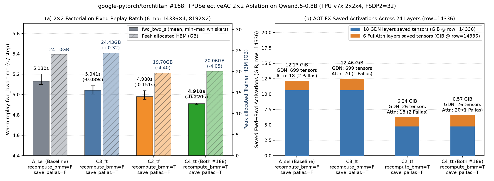
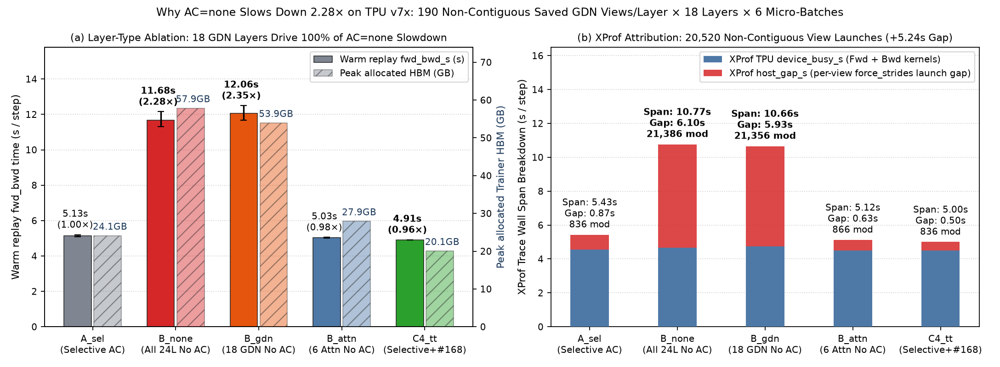
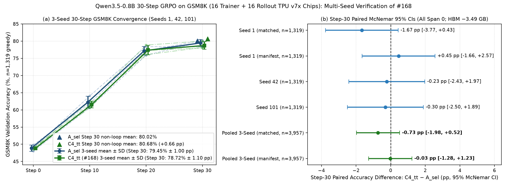

# torchtitan #168: review and benchmark evidence (`TPUSelectiveAC` `recompute_bmm` and `save_pallas_attention`)

[Upstream pull request](https://github.com/google-pytorch/torchtitan/pull/168) · head `fac85b8bd1e3` on base `cfbb77688269`

Reviewed head `fac85b8bd1e3` against merge base `cfbb77688269`. We independently validated both flags (`recompute_bmm` and `save_pallas_attention`) in `TPUSelectiveAC` on TPU v7x using Qwen3.5-0.8B GRPO training (`16 trainer + 16 rollout` TPU v7x chips) across a locked-layout 2×2 fixed-batch replay, XProf device trace and AOT FX / XLA HLO inspection, and a 3-seed (`seeds 1, 42, 101`) 30-step GSM8K convergence study.

We support merging this PR: both flags work orthogonally as designed, preserve single-step numerical fidelity (`pg_loss` diff `0.0` to `3.72e-5`, $\Delta W$ cosine `0.9889`–`0.99996` vs. `A_sel`, and bit-identical $\Delta W$ between `C4_tt` and `C2_tf`), reduce peak trainer HBM by **3.49–4.05 GB (14.8–16.8%)**, improve trainer step time / MFU by **2.7–4.3%**, and show **no observed accuracy regression** across 3 seeds on 30-step GSM8K GRPO.

---

## 1. Test Environment and Code Provenance

- **Hardware & topology:** 32 TPU v7x chips per run — 16 trainer chips (`2x2x4` slice, 32 TensorCores, FSDP2 `dp=32`, per-block `torch.compile` in `eager_blocks` mode) + 16 rollout chips (`4 × 2x2x1` slices, `16 × TP=2` vLLM rollout engines). All 7 fixed-batch replay arms ran on the **exact same physical `2x2x4` trainer slice** (`host-00..03`) to eliminate machine-to-machine variance.
- **Model & workload:** `Qwen/Qwen3.5-0.8B` (`2fc06364`, text-only conversion, 24 layers = **18 Gated DeltaNet [GDN]** linear-attention layers + **6 Full-Attention** Pallas Splash Attention layers, `tie_word_embeddings=True`, `model_kernels=none`), GSM8K (`7,473` train / `1,319` test prompts, `128 prompts × 16 rollouts = 2,048 trajectories/step`, max prompt/response `256 / 4,096` tokens, `lr=2.5e-6`).
- **Software stack:** Python `3.12.12`, `torch 2.13.0+cpu`, `torch_tpu 0.2.0`, `libtpu 0.0.50`, `jax 0.12.0.1`, `vllm 0.32.0`. The trainer base image used `torchtitan` `aaf742e4` with `torchtitan/experiments/tpu/components/activation_checkpoint.py` replaced by the exact file from PR #168 ([`patches/activation_checkpoint_pr168.py`](patches/activation_checkpoint_pr168.py), commit `fac85b8b`, SHA-256 `3d4fd13f8c554fc97783728a2ec4efbfa763931bdf0da2eaf970fef5a46c9a55`, diff in [`patches/torchtitan-pr168-activation-checkpoint.diff`](patches/torchtitan-pr168-activation-checkpoint.diff), verified before every run via `[AC-AUDIT]`).

---

## 2. Fixed-Batch 2×2 Factorial Replay, Single-Step Numerical Equivalence, and Compiler Attribution

We froze a real Step-1 GRPO training batch (`2,328,294` valid tokens across 32 FSDP2 ranks, SHA-256 `e3d67e4f…`) and locked the micro-batch shape planner to `[14336, 14336, 14336, 14336, 8192, 8192]` (`6` micro-batches/step, `2,359,296` padded tokens, `98.69%` token fill). Each arm ran 1 cold compilation step followed by 5 warm timed iterations with the profiler disabled, then 1 separate iteration with XProf and AOT FX / XLA HLO dumping enabled ([`summaries/stage1_replay_comparison.json`](summaries/stage1_replay_comparison.json), [`summaries/xprof_7cat_comparison.json`](summaries/xprof_7cat_comparison.json), [`summaries/hlo_fx_comparison_14336.json`](summaries/hlo_fx_comparison_14336.json), [`summaries/ab_compile_token_summary.json`](summaries/ab_compile_token_summary.json)).

| Arm | `ac_mode` | `recompute_bmm` | `save_pallas_attention` | Cold Compile Span (`s`) / Count (`HLO` / `AOT FX` / `Warm Recompile`) | Real / Padded Tokens (Fill %) | Micro-Batches (`layout_rows`) | GDN Saved Tensors / Layer (`row=14336`) | FullAttn Saved Tensors / Layer (`row=14336`) | XProf XLA Modules / Step | Warm `fwd_bwd_s` (mean, `s`) | Warm `engine_update_actor_s` (`s`) | Peak Allocated HBM (`GB`) | vs. `A_sel` Time / HBM Delta | `pg_loss` / `grad_norm` | $\Delta W$ vs. `A_sel` (`max_abs_diff` / `cosine` / `sign`) |
|---|---|:---:|:---:|---:|---:|---:|---:|---:|---:|---:|---:|---:|---|---:|---:|
| **`A_sel` (Baseline)** | `selective` | `False` | `False` | `307.81 s` (`296` / `8` / `0`) | `2.328M / 2.359M` (`98.69%`) | `6` (`14336×4, 8192×2`) | `699` (`604.74 MiB`) | `18` (`256.42 MiB`, `2` Pallas calls) | `836` | `5.1302 s` | `5.4201 s` | `24.10 GB` | Baseline | `0.090924` / `0.333176` | `0.0` / `1.000000` / `100.00%` |
| `C3_ft` (`save_pallas` only) | `selective` | `False` | **`True`** | `308.01 s` (`296` / `8` / `0`) | `2.328M / 2.359M` (`98.69%`) | `6` (`14336×4, 8192×2`) | `699` (`604.74 MiB`) | **`20` (`312.86 MiB`, `1` Pallas call)** | `836` | `5.0412 s` | `5.3547 s` | `24.43 GB` | **`-0.089 s` (`-1.7%`)** / `+0.32 GB` | `0.090924` / `0.333170` | **`3.20e-7` / `0.999960` / `99.98%`** |
| `C2_tf` (`recompute_bmm` only) | `selective` | **`True`** | `False` | `303.92 s` (`296` / `8` / `0`) | `2.328M / 2.359M` (`98.69%`) | `6` (`14336×4, 8192×2`) | **`26` (`269.24 MiB`)** | `18` (`256.42 MiB`, `2` Pallas calls) | `836` | `4.9796 s` | `5.2685 s` | **`19.70 GB`** | **`-0.151 s` (`-2.9%`) / `-4.40 GB` (`-18.3%`)** | `0.090961` / `0.332724` | **`4.99e-7` / `0.988937` / `99.20%`** |
| **`C4_tt` (Both #168 flags)** | **`selective`** | **`True`** | **`True`** | **`305.70 s` (`296` / `8` / `0`)** | **`2.328M / 2.359M` (`98.69%`)** | **`6` (`14336×4, 8192×2`)** | **`26` (`269.24 MiB`)** | **`20` (`312.86 MiB`, `1` Pallas call)** | **`836`** | **`4.9099 s`** | **`5.1973 s`** | **`20.06 GB`** | **`-0.220 s` (`-4.3%`) / `-4.05 GB` (`-16.8%`)** | **`0.090961` / `0.332724`** | **`4.99e-7` / `0.988937` / `99.20%` (`1.000000` vs. `C2_tf`)** |
| `B_none` (`AC=none`, all 24L) | `none` | — | — | `300.09 s` (`303` / `8` / `0`) | `2.328M / 2.359M` (`98.69%`) | `6` (`14336×4, 8192×2`) | `1,625` (`2,214.77 MiB`) | `36` (`822.39 MiB`, `1` Pallas call) | `21,386` | `11.6777 s` | `11.9751 s` | `57.86 GB` | `+6.548 s` (`2.28×` slower) / `+33.76 GB` | `0.090858` / `0.336094` | `5.00e-7` / `0.959694` / `97.58%` |
| `B_gdn` (18 GDN layers no AC) | `selective` | `False` | `False` | `293.81 s` (`301` / `8` / `0`) | `2.328M / 2.359M` (`98.69%`) | `6` (`14336×4, 8192×2`) | `1,625` (`2,214.77 MiB`) | `18` (`256.42 MiB`, `2` Pallas calls) | `21,356` | `12.0615 s` | `12.3574 s` | `53.95 GB` | `+6.931 s` (`2.35×` slower) / `+29.85 GB` | `0.090902` / `0.324003` | `5.00e-7` / `0.958216` / `97.51%` |
| `B_attn` (6 Attn layers no AC) | `selective` | `False` | `False` | `312.14 s` (`298` / `8` / `0`) | `2.328M / 2.359M` (`98.69%`) | `6` (`14336×4, 8192×2`) | `699` (`604.74 MiB`) | `36` (`822.39 MiB`, `1` Pallas call) | `866` | `5.0278 s` | `5.3525 s` | `27.92 GB` | `-0.102 s` (`-2.0%`) / `+3.82 GB` | `0.090808` / `0.330144` | `5.00e-7` / `0.963115` / `97.76%` |



*Left: Warm fixed-batch replay `fwd_bwd_s` (mean with min–max whiskers across 5 warm iterations, profiler off) and peak allocated HBM across the 2×2 `TPUSelectiveAC` factorial. Right: AOT FX partitioner forward-to-backward saved activations across 18 GDN and 6 Full-Attention layers at `row = 14,336`.*

### Key Technical Findings from Stage 1

1. **Single-step numerical equivalence and run-to-run noise floor (`A/A`, `C4/C4`, and `A/C4`, [`summaries/noise_floor_comparison.json`](summaries/noise_floor_comparison.json)):**
   - **Same-slice run-to-run noise floor (`A/A` and `C4/C4`):** On the exact same `2x2x4` trainer slice and frozen Step-1 batch (`e3d67e4f…`), repeating `A_sel` (`A_sel_rep1` vs. `A_sel_rep2`) yields `pg_loss` `abs_diff = 0.0` (`0.09092408`), `grad_norm` `rel_diff = 7.16e-6` (`0.33317345` vs. `0.33317584`), and $\Delta W$ `cosine = 0.999938` (`sign_agreement = 99.97%`, `max_abs_diff = 2.89e-7`; `A_sel_rep2` vs. Stage-1 `A_sel` is bit-identical `1.000000`). Repeating `C4_tt` (`C4_tt_rep1` vs. `C4_tt_rep2` and vs. Stage-1 `C4_tt`) is **100% bit-identical (`pg_loss` `abs_diff = 0.0`, `grad_norm` `rel_diff = 0.0`, $\Delta W$ `cosine = 1.000000`, `sign_agreement = 100.00%`, `max_abs_diff = 0.0`)**.
   - **`save_pallas_attention=True` (`C3_ft` vs. `A_sel`, and `C4_tt` vs. `C2_tf`):** `C3_ft` vs. `A_sel` (`pg_loss` `abs_diff = 0.0`, `grad_norm` `rel_diff = 1.79e-5`, $\Delta W$ `cosine = 0.999960`, `sign_agreement = 99.98%`, `max_abs_diff = 3.20e-7`) lies **completely within the `A/A` run-to-run noise floor (`0.999938`)**, and `C4_tt` vs. `C2_tf` is **100% bit-identical (`cosine = 1.000000`, `max_abs_diff = 0.0`)**.
   - **`recompute_bmm=True` (`A/C4` = `0.988937`–`0.988949`, `sign_agreement = 99.20%`–`99.21%`):** Because `C4/C4` is `1.000000` and `A/A` is `0.999938`–`1.000000`, the `0.988937`–`0.988949` $\Delta W$ cosine (`pg_loss` `abs_diff = 3.72e-5`, `grad_norm` `rel_diff = 1.35e-3`–`1.36e-3`) between `C2_tf`/`C4_tt` and `A_sel` is a **100% reproducible, deterministic XLA fusion shift**: recomputing the `673` `bmm` ops per GDN layer in backward fuses them with downstream backward ops (`2,286 -> 2,833` backward HLO fusions at `row=14336`, keeping `PROMOTE_F32` accumulation inside fused kernels rather than truncating to BF16 at the AOT forward graph boundary), vs. `0.959694` (`97.58%`) when AC is disabled in `B_none`.

| Pairwise Replay Comparison (`Base` vs. `Arm`) | `pg_loss` (`Base` vs. `Arm`) | `pg_loss` `abs_diff` | `grad_norm` (`Base` vs. `Arm`) | `grad_norm` `rel_diff` | $\Delta W$ `cosine` | $\Delta W$ `sign_agreement` | $\Delta W$ `max_abs_diff` |
|---|---|---:|---|---:|---:|---:|---:|
| **`A/A` Same-Slice Repeat (`A_sel_rep1` vs. `A_sel_rep2`)** | `0.09092408` vs. `0.09092408` | **`0.00e+00`** | `0.33317345` vs. `0.33317584` | **`7.16e-06`** | **`0.999938`** | **`99.97%`** | `2.89e-07` |
| **`A/A` Cross-Slice Repeat (`A_sel` Stage 1 vs. `A_sel_rep2`)** | `0.09092408` vs. `0.09092408` | **`0.00e+00`** | `0.33317584` vs. `0.33317584` | **`0.00e+00`** | **`1.000000`** | **`100.00%`** | `0.00e+00` |
| **`C4/C4` Same-Slice & Cross-Slice (`C4_tt_rep1` vs. `C4_tt_rep2` / `C4_tt`)** | `0.09096132` vs. `0.09096132` | **`0.00e+00`** | `0.33272433` vs. `0.33272433` | **`0.00e+00`** | **`1.000000`** | **`100.00%`** | **`0.00e+00`** |
| **`save_pallas=T` Alone (`A_sel` vs. `C3_ft`)** | `0.09092408` vs. `0.09092408` | **`0.00e+00`** | `0.33317584` vs. `0.33316988` | **`1.79e-05`** | **`0.999960`** | **`99.98%`** | `3.20e-07` |
| **`save_pallas=T` on `recompute_bmm=T` (`C2_tf` vs. `C4_tt`)** | `0.09096132` vs. `0.09096132` | **`0.00e+00`** | `0.33272433` vs. `0.33272433` | **`0.00e+00`** | **`1.000000`** | **`100.00%`** | **`0.00e+00`** |
| **`A/C4` Same-Slice 1 (`A_sel_rep1` vs. `C4_tt_rep1`)** | `0.09092408` vs. `0.09096132` | `3.72e-05` | `0.33317345` vs. `0.33272433` | `1.35e-03` | **`0.988949`** | **`99.21%`** | `4.99e-07` |
| **`A/C4` Same-Slice 2 & Stage 1 (`A_sel_rep2` vs. `C4_tt_rep2` / `A_sel` vs. `C4_tt`)** | `0.09092408` vs. `0.09096132` | `3.72e-05` | `0.33317584` vs. `0.33272433` | `1.36e-03` | **`0.988937`** | **`99.20%`** | `4.99e-07` |
| **Reference: `AC=none` (`A_sel` vs. `B_none`)** | `0.09092408` vs. `0.09085808` | `6.60e-05` | `0.33317584` vs. `0.33609411` | `8.76e-03` | `0.959694` | `97.58%` | `5.00e-07` |
2. **Orthogonal and additive mechanism of the two flags:**
   - **`recompute_bmm=True` (`C2_tf`):** Removes `aten.bmm.default` from `_TPU_SAVE_OPS`. In each GDN layer (`row=14336`), the 64-token chunk recurrence loop executes `673` small `bmm` operations. Recomputing them in backward reduces AOT FX saved tensors per GDN layer from **`699` (`604.74 MiB`) to `26` (`269.24 MiB`)** (`-55.5%` per layer, `-5.90 GiB` across 18 GDN layers), cutting peak trainer HBM by **`-4.40 GB`** and speeding up `fwd_bwd_s` by **`-0.151 s` (`-2.9%`)**.
   - **`save_pallas_attention=True` (`C3_ft`):** Adds `torch_tpu.pallas_call.default` to `_TPU_SAVE_OPS`. In each Full-Attention layer (`row=14336`), saving the `56.44 MiB` Pallas Splash Attention outputs (`18 -> 20` saved tensors/layer, `256.42 -> 312.86 MiB`) eliminates the forward-recomputation Pallas custom call during backward (`2 -> 1` Pallas call in backward HLO). XProf confirms `full_attention` backward kernel time drops from `0.4982 s` to `0.4276 s` (**`-0.0706 s`** in `C3_ft`, `-0.0715 s` in `C4_tt`, matching the `-0.089 s` wall-clock improvement).
   - **Combined (`C4_tt`):** Delivers the sum of both improvements — **`-0.220 s` (`-4.3%`) faster `fwd_bwd_s`** and **`-4.05 GB` (`-16.8%`) lower peak HBM**.
3. **Why `AC=none` (`B_none`, [Issue #3](https://github.com/syangx39/PR-reviews/issues/3)) is `2.28×` slower on TPU v7x (and why `TPUSelectiveAC` + `#168` is the right path):**
   - Our layer-type split arms (`B_gdn` and `B_attn`) prove that **100% of the `AC=none` slowdown originates in the 18 GDN layers**: disabling AC only on the 18 GDN layers (`B_gdn`) slows `fwd_bwd_s` to `12.06 s` (`2.35×`), whereas disabling AC only on the 6 Full-Attention layers (`B_attn`) is `-0.102 s` faster (`5.03 s`).
   - Without `torch.utils.checkpoint` on GDN layers, AOT Autograd saves **`1,625` tensors (`2,214.77 MiB`) per GDN layer**, of which **`190` tensors are non-contiguous view/slice/transpose (`as_strided`) outputs** from the chunk recurrence loop. Under `torch_tpu`'s `DEFER_AND_FUSE` (`execute_force_strides`), materializing those views before backward launches a separate 1-op JIT XLA module (`tt_jit_execute_force_strides_as_strided_inverse`) per tensor, exploding XLA module launches per step from **`836` (`A_sel` / `C4_tt`) to `21,386` (`B_none`) / `21,356` (`B_gdn`)** (`+20,520 = 190 × 18 layers × 6 micro-batches`) and inflating XProf `host_gap` from **`0.87 s` to `6.10 s` (`+5.24 s`)**.



*Left: Layer-type split ablation (`A_sel`, `B_none`, `B_gdn`, `B_attn`, `C4_tt`) on the locked-layout replay batch. Right: XProf breakdown into `device_busy_s` vs. `host_gap_s` and total XLA module launches per step.*

---

## 3. Multi-Seed (Seeds 1, 42, 101) 30-Step GSM8K GRPO Convergence and Performance

To verify that `#168` introduces no training-quality regression over multi-step RL trajectories, we ran 30-step GSM8K GRPO training (full `1,319`-prompt greedy validation at Steps `0, 10, 20, 30`) comparing `A_sel` (`recompute_bmm=False, save_pallas_attention=False`) and `C4_tt` (`recompute_bmm=True, save_pallas_attention=True`) across 3 seeds (`1, 42, 101`) ([`summaries/multiseed_comparison.json`](summaries/multiseed_comparison.json)).

| Run / Aggregate | Arm (`recompute_bmm`, `save_pallas`) | Seed | Steps `[4, 30]` Pre-warm Compile (`s`, `3` buckets) | Steps `[4, 30]` Real / Padded Tokens (Fill %) | Steps `[4, 30]` `mb/step` | `step_s` excl. ckpt (`s`) | `update_actor` Driver / Engine (`s`) | Trainer Engine MFU | Peak Trainer HBM (`GB`) | GSM8K Val `Step 0 -> 10 -> 20 -> 30` (greedy loops `TAIL=2000, ratio<0.20`) | **Step 30 Raw Acc (`correct/1319`)** | **Step 30 Non-Loop Acc** |
|---|---|---:|---:|---:|---:|---:|---:|---:|---:|---|---:|---:|
| `a_sel_s1` (matched) | `A_sel` (`F, F`) | `1` | `266.5 s` | `2.153M / 2.199M` (`97.85%`) | `7.22` | `26.92 s` | `7.10 / 4.98 s` | `5.80%` | `23.51 GB` | `47.99% (19) -> 60.65% (12) -> 75.89% (7) -> 79.83% (21)` | `79.83%` (`1053`) | `81.12%` |
| `a_sel_s1_manifest` | `A_sel` (`F, F`) | `1` | `258.4 s` | `2.176M` / — | — | `25.86 s` | `6.12` / — | — | `23.58 GB` | `47.76% (18) -> 59.21% (10) -> 74.22% (6) -> 77.71% (38)` | `77.71%` (`1025`) | `79.94%` |
| **`c4_tt_s1`** | **`C4_tt` (`T, T`)** | **`1`** | **`263.6 s`** | **`2.425M / 2.476M` (`97.93%`)** | **`7.89`** | **`27.75 s`** | **`7.48 / 5.41 s`** | **`6.02%`** | **`20.04 GB`** | **`48.98% (18) -> 61.49% (11) -> 76.04% (11) -> 78.17% (16)`** | **`78.17%` (`1031`)** | **`79.13%`** |
| `a_sel_s42` | `A_sel` (`F, F`) | `42` | `266.6 s` | `2.110M / 2.155M` (`97.86%`) | `6.22` | `27.01 s` | `7.08 / 4.83 s` | `5.84%` | `23.55 GB` | `49.81% (17) -> 61.94% (12) -> 77.18% (5) -> 80.21% (2)` | `80.21%` (`1058`) | `80.33%` |
| **`c4_tt_s42`** | **`C4_tt` (`T, T`)** | **`42`** | **`266.5 s`** | **`1.918M / 1.961M` (`97.73%`)** | **`6.15`** | **`26.26 s`** | **`6.34 / 4.33 s`** | **`5.92%`** | **`20.04 GB`** | **`48.52% (20) -> 62.55% (9) -> 78.85% (3) -> 79.98% (33)`** | **`79.98%` (`1055`)** | **`82.04%`** |
| `a_sel_s101` | `A_sel` (`F, F`) | `101` | `266.7 s` | `2.225M / 2.267M` (`98.15%`) | `7.70` | `27.79 s` | `7.30 / 5.12 s` | `5.85%` | `23.52 GB` | `48.82% (14) -> 64.06% (12) -> 78.39% (10) -> 78.32% (5)` | `78.32%` (`1033`) | `78.61%` |
| **`c4_tt_s101`** | **`C4_tt` (`T, T`)** | **`101`** | **`266.9 s`** | **`2.137M / 2.182M` (`97.88%`)** | **`7.07`** | **`26.86 s`** | **`6.94 / 4.77 s`** | **`6.02%`** | **`20.04 GB`** | **`48.90% (23) -> 60.58% (12) -> 77.26% (5) -> 78.01% (48)`** | **`78.01%` (`1029`)** | **`80.88%`** |
| **3-Seed Mean ± SD (`A_sel` matched)** | `A_sel` (`F, F`) | `1,42,101` | `266.6 ± 0.1 s` | `2.163M / 2.207M` (`97.95%`) | `7.05 ± 0.76` | `27.24 ± 0.48 s` | `7.16 / 4.98 ± 0.14 s` | `5.83% ± 0.02%` | `23.53 ± 0.02 GB` | `48.88%±0.91 -> 62.22%±1.72 -> 77.15%±1.25 -> 79.45%±1.00` | **`79.45% ± 1.00 pp`** | **`80.02% ± 1.28 pp`** |
| **3-Seed Mean ± SD (`C4_tt` #168)** | **`C4_tt` (`T, T`)** | **`1,42,101`** | **`265.7 ± 1.8 s`** | **`2.160M / 2.206M` (`97.85%`)** | **`7.04 ± 0.87`** | **`26.96 ± 0.75 s`** | **`6.92 / 4.83 ± 0.54 s`** | **`5.99% ± 0.06%`** | **`20.04 ± 0.00 GB`** | **`48.80%±0.24 -> 61.54%±0.99 -> 77.38%±1.41 -> 78.72%±1.10`** | **`78.72% ± 1.10 pp`** | **`80.68% ± 1.47 pp`** |

### Paired McNemar Tests (`C4_tt − A_sel`)

| Paired Comparison (`C4_tt − A_sel`) | `n` | Step 0 `diff` (`95% CI`) | Step 10 `diff` (`95% CI`) | Step 20 `diff` (`95% CI`) | **Step 30 `diff` (`95% CI`, `onlyC4/onlyA`, $z$)** | **95% CI Spans 0?** | Step 30 Non-Loop `C4_tt vs. A_sel` |
|---|---:|---|---|---|---|:---:|---|
| **Seed 1 (vs. matched `a_sel_s1`)** | `1,319` | `+0.99 pp` (`[-0.65, +2.62]`) | `+0.83 pp` (`[-1.49, +3.16]`) | `+0.15 pp` (`[-2.02, +2.33]`) | **`-1.67 pp` (`[-3.77, +0.43]`, `89/111`, $z=-1.56$)** | **Yes** | `79.13%` vs. `81.12%` |
| **Seed 1 (vs. manifest `a_sel_s1_manifest`)** | `1,319` | `+1.21 pp` (`[-0.52, +2.94]`) | `+2.27 pp` (`[-0.18, +4.73]`) | `+1.82 pp` (`[-0.44, +4.08]`) | **`+0.45 pp` (`[-1.66, +2.57]`, `104/98`, $z=+0.42$)** | **Yes** | `79.13%` vs. `79.94%` |
| **Seed 42** | `1,319` | `-1.29 pp` (`[-2.94, +0.36]`) | `+0.61 pp` (`[-1.71, +2.93]`) | `+1.67 pp` (`[-0.47, +3.81]`) | **`-0.23 pp` (`[-2.43, +1.97]`, `108/111`, $z=-0.20$)** | **Yes** | **`82.04%` vs. `80.33%` (`+1.71 pp`)** |
| **Seed 101** | `1,319` | `+0.08 pp` (`[-1.62, +1.78]`) | `-3.49 pp` (`[-5.89, -1.09]`) | `-1.14 pp` (`[-3.19, +0.92]`) | **`-0.30 pp` (`[-2.50, +1.89]`, `107/111`, $z=-0.27$)** | **Yes** | **`80.88%` vs. `78.61%` (`+2.27 pp`)** |
| **Pooled 3-Seed (matched Seed 1)** | **`3,957`** | **`-0.08 pp` (`[-1.03, +0.88]`)** | **`-0.68 pp` (`[-2.04, +0.67]`)** | **`+0.23 pp` (`[-1.00, +1.45]`)** | **`-0.73 pp` (`[-1.98, +0.52]`, `304/333`, $z=-1.15$)** | **Yes** | **`80.68%` vs. `80.02%` (`+0.66 pp`)** |
| **Pooled 3-Seed (manifest Seed 1)** | **`3,957`** | **`+0.00 pp` (`[-0.98, +0.98]`)** | **`-0.20 pp` (`[-1.59, +1.18]`)** | **`+0.78 pp` (`[-0.46, +2.03]`)** | **`-0.03 pp` (`[-1.28, +1.23]`, `319/320`, $z=-0.04$)** | **Yes** | **`80.68%` vs. `79.63%` (`+1.05 pp`)** |



*Left: 3-seed (`1, 42, 101`) 30-step GSM8K validation trajectories (individual seeds and 3-seed mean ± SD, plus Step-30 non-loop accuracy markers). Right: Step-30 paired McNemar differences (`C4_tt − A_sel`) and 95% confidence intervals across individual seeds ($n=1,319$) and pooled 3-seed comparisons ($n=3,957$).*

---

## 4. Scope Limitations and Downstream Integration Note

- **Tested scope & limitations:**
  1. **Model & kernel path:** Validated on dense `Qwen3.5-0.8B` (18 GDN + 6 Full-Attention layers) with `model_kernels=none` (XLA GDN path, where GDN chunk recurrence uses `aten.bmm.default`). We did not test the Tokamax KDA Pallas kernel path (`model_kernels=kda`, covered by `torchtitan#170`), MoE models (`Qwen3.5-35B-A3B`), or context parallelism (`CP > 1`).
  2. **Compile mode & sequence length buckets:** Tested under per-block `torch.compile` (`eager_blocks`) with micro-batch token buckets `{8192, 14336}` (`16384` was pre-warmed during Step 1 but not selected during steady-state steps `4–30`). Whole-graph `TpuGraphTrainer` mode (`verl-hardware-plugin#134`) was not tested here.
  3. **Fixed-batch numerical check:** Single-step $\Delta W$ equivalence (`cosine = 0.999960` for `C3_ft`, `cosine = 0.988937` for `C2_tf`/`C4_tt` vs. `A_sel`, and bit-identical between `C4_tt` and `C2_tf`) was verified on one frozen real training batch (`6` micro-batches, `2,328,294` real tokens) at Step 1.
- **Downstream `verl-hardware-plugin` import-path caveat:**
  - Commit `dc61deb9` in `google-pytorch/torchtitan` moved `TPUSelectiveAC` from `torchtitan.experiments.tpu.activation_checkpoint` to `torchtitan.experiments.tpu.components.activation_checkpoint`. Downstream `verl-hardware-plugin` (`torchtitan_tpu.py`) currently imports the legacy module path inside a `try / except ImportError` block that silently falls back to core `SelectiveAC`. When integrating `#168` into `verl-hardware-plugin`, the plugin should import from `torchtitan.experiments.tpu.components.activation_checkpoint` (with a fallback to the legacy path and a fail-closed check against `SelectiveAC`) and wire `recompute_bmm` and `save_pallas_attention` into `TPUSelectiveAC.Config`.

---

## 5. Reproduce the Verification and Figures

From this folder (`torchtitan/168/`):

```bash
# 1. Verify all summary JSONs, single-step delta_W checks, XProf/HLO counts, and paired McNemar CIs (Python 3 standard library):
python3 tools/verify_pr168_evidence.py

# 2. Regenerate the three figures from summaries/ (requires matplotlib and numpy):
python3 tools/plot_168.py
```
